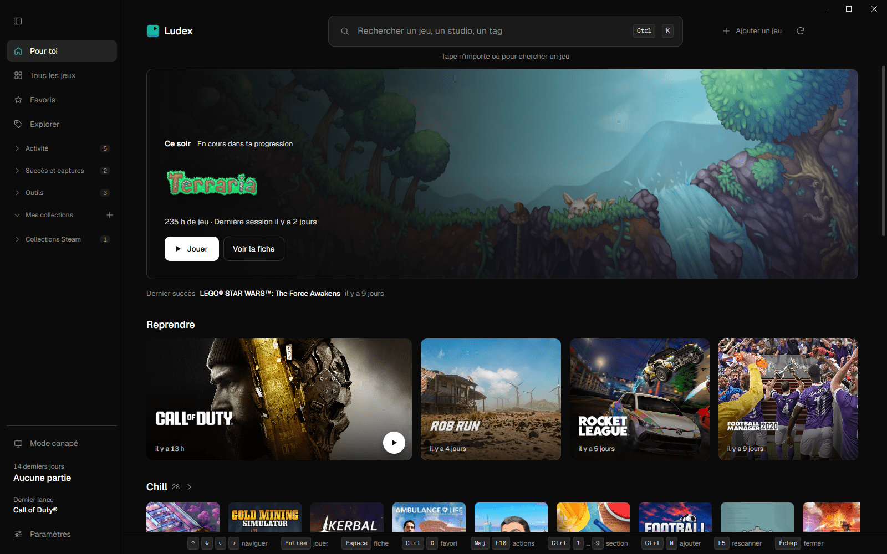
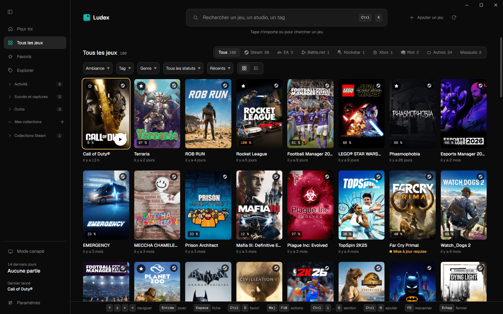
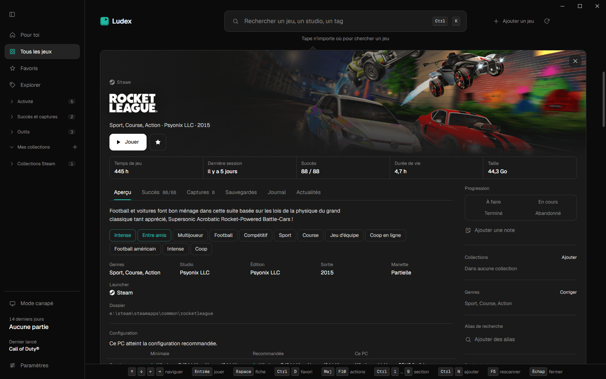
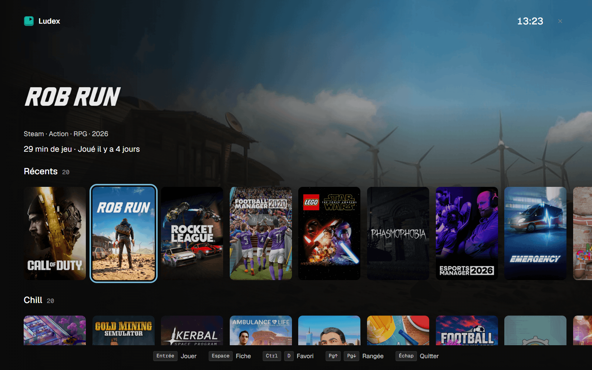
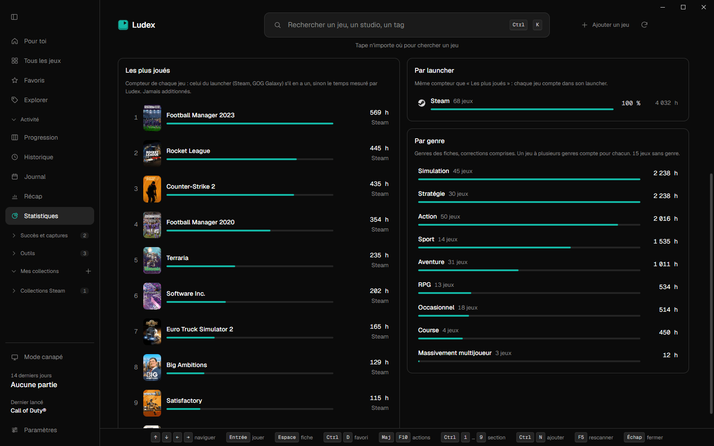
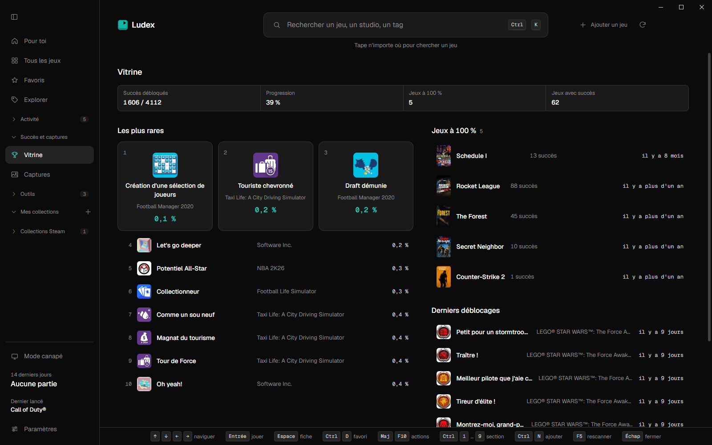
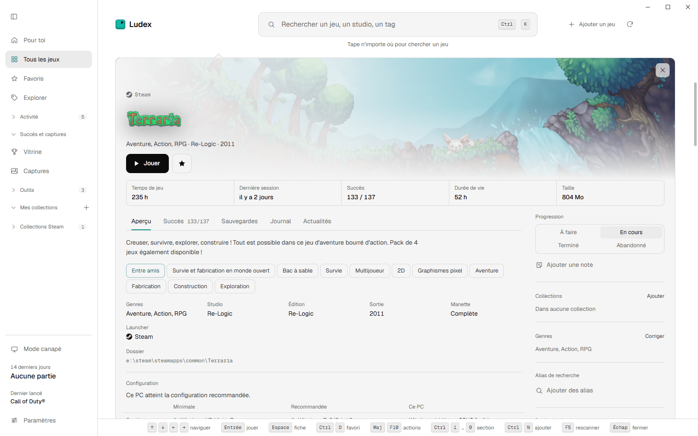
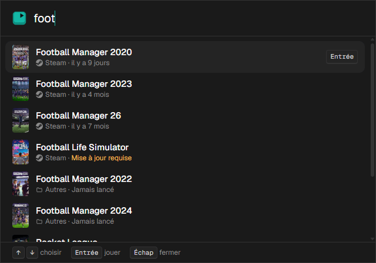

# Ludex

**Français** · [English](README.en.md)

Ludex réunit dans une seule bibliothèque les jeux installés sur ton PC Windows, quel que soit leur launcher, et les lance d'un clic ou d'un bouton de manette. Il lit ce que les launchers enregistrent déjà sur le disque : pas de compte à relier, pas de mot de passe, rien à configurer.



## Principes

- **Lecture locale** : Ludex lit les fichiers et le registre des launchers installés, en lecture seule. Le jeu est toujours lancé par son launcher d'origine (ou par son exécutable quand il n'en a pas).
- **Aucun compte** : aucune connexion à Steam, Epic, GOG ou autre. Ludex ne demande ni identifiant ni jeton.
- **Aucune télémétrie** : ni statistiques d'usage, ni rapport de plantage envoyé. Les quelques services publics contactés (images, fiches, durées de vie, mises à jour) sont listés plus bas, avec ce qui leur est envoyé.
- **Tes données restent chez toi** : favoris, collections, notes, temps de jeu mesuré et réglages sont dans `%APPDATA%\com.ludex.app`. Tu peux les exporter dans une archive pour changer de PC.

## Launchers reconnus

| Source | Ce que Ludex lit |
| --- | --- |
| Steam | Bibliothèques Steam, temps de jeu, succès, captures, collections, mods Workshop |
| Epic Games | Manifestes des jeux installés |
| GOG | Registre, temps de jeu de GOG Galaxy |
| Ubisoft Connect | Registre |
| EA app | Dossiers de jeux (manifestes d'installation) |
| Battle.net | Dossiers de jeux |
| Rockstar Games Launcher | Registre |
| Xbox et Microsoft Store | Paquets de jeux installés |
| Riot Games | Fichiers du client Riot |
| Amazon Games | Base locale de l'appli (lecture seule) |
| itch.io | Base locale de l'appli (lecture seule) |
| Autres | Dossiers « Jeux » ou « Games » de tes disques, jeux ajoutés à la main, FiveM, RedM, Roblox, jeux Ankama… |

## Fonctions principales

- Bibliothèque en grille ou en liste, tris, filtres par launcher, genre, tag et ambiance, recherche tolérante aux fautes (« gta5 », « fm20 », « rocet »).
- Accueil « Pour toi » : jeu du soir, parties à reprendre, idées par ambiance, pile de jeux pas encore lancés.
- Fiche de chaque jeu : temps de jeu, sessions, succès Steam, captures, sauvegardes, configuration requise comparée à ton PC, actualités, mods, performances.
- Temps de jeu mesuré par Ludex pour les launchers qui n'en gardent pas (Epic, Ubisoft, Riot, Xbox…), historique, journal, récap de la semaine, du mois et de l'année, statistiques.
- Copie automatique des sauvegardes en fin de partie (emplacements de la base communautaire Ludusavi) et restauration.
- Mode canapé pour la TV, entièrement à la manette.
- Recherche rapide de n'importe où (Alt+Espace par défaut), zone de notification, Jump List et raccourcis sur le Bureau.
- Stockage : place des jeux par disque et jeux à désinstaller.
- Liste de souhaits Steam avec alertes de promo, sans compte.
- Thèmes sombre, clair, noir OLED et contraste élevé, cinq couleurs d'accent, interface en français et en anglais.

<table>
  <tr>
    <td width="50%"><br><sub>Bibliothèque en grille, filtres par launcher, genre, tag et ambiance</sub></td>
    <td width="50%"><br><sub>Fiche d'un jeu (onglet Aperçu)</sub></td>
  </tr>
  <tr>
    <td width="50%"><br><sub>Mode canapé pour la TV, à la manette</sub></td>
    <td width="50%"><br><sub>Statistiques de jeu</sub></td>
  </tr>
  <tr>
    <td width="50%"><br><sub>Vitrine des succès Steam</sub></td>
    <td width="50%"><br><sub>Thème clair</sub></td>
  </tr>
  <tr>
    <td width="50%"><br><sub>Recherche rapide (Alt+Espace)</sub></td>
  </tr>
</table>

## Installation

1. Télécharge `Ludex_<version>_x64-setup.exe` depuis la [dernière release](https://github.com/Nerow75/ludex/releases/latest).
2. Lance-le. L'installation se fait pour ton seul compte Windows (dans `%LOCALAPPDATA%\Ludex`), sans droits administrateur.
3. **SmartScreen** : l'installeur n'est pas encore signé, Windows peut afficher « Windows a protégé votre ordinateur ». Clique sur **Informations complémentaires**, puis sur **Exécuter quand même**. L'avertissement s'estompe à mesure que le fichier est téléchargé.

Configuration requise : Windows 10 ou 11, 64 bits, avec WebView2 (présent sur Windows 11, téléchargé depuis Microsoft par l'installeur s'il manque).

### Mises à jour

Ludex vérifie les nouvelles versions 8 secondes après son ouverture, puis toutes les 12 heures. Quand une version est disponible, un message propose « Installer et relancer » : l'installeur est téléchargé depuis les releases GitHub, sa signature est vérifiée, puis Ludex redémarre. Rien n'est installé sans ton clic.

## Raccourcis

### Clavier

| Touche | Action |
| --- | --- |
| Taper n'importe où, Ctrl+K | Rechercher |
| Flèches | Se déplacer |
| Entrée | Jouer |
| Espace | Ouvrir ou fermer la fiche |
| Échap | Fermer, effacer la recherche |
| Ctrl+D | Favori |
| Ctrl+N | Ajouter un jeu |
| Touche Menu, Maj+F10 | Menu du jeu |
| Ctrl+1 à Ctrl+9 | Changer de section |
| Ctrl+, | Paramètres |
| F5 | Relire les launchers |
| F11 | Mode canapé |
| Alt+Espace | Recherche rapide, même Ludex en arrière-plan (modifiable) |

### Manette

| Bouton | Action |
| --- | --- |
| Croix, stick gauche | Se déplacer |
| A | Jouer |
| X | Fiche |
| Y | Favori |
| B | Retour |
| LB, RB | Section précédente ou suivante |
| LT, RT | Filtre précédent ou suivant |
| Vue | Tri suivant |
| Menu | Menu du jeu |
| Vue + Menu | Mode canapé |

## Confidentialité

Ludex ne crée aucun compte et n'envoie aucune télémétrie. Il contacte seulement les services publics ci-dessous, sans identifiant, et toujours depuis ton PC (aucun serveur de Ludex au milieu). Chaque service voit ton adresse IP, comme pour toute connexion. Le détail, requête par requête, est dans [PRIVACY.md](PRIVACY.md).

| Service | Pourquoi | Ce qui est envoyé |
| --- | --- | --- |
| `github.com` | Mises à jour de Ludex | Rien (lecture de la dernière version, puis téléchargement de l'installeur) |
| `raw.githubusercontent.com` | Base des sauvegardes Ludusavi | Rien (téléchargement de la liste, une fois par semaine au plus) |
| `store.steampowered.com` | Jaquettes, configuration requise, liste de souhaits | Titres des jeux à habiller, numéros Steam (appids), texte cherché dans les souhaits |
| `api.steampowered.com` | Fiches, tags, actualités, rareté des succès, mods | Numéros Steam des jeux et des mods, langue |
| `displaycatalog.mp.microsoft.com` | Jaquettes des jeux absents de Steam | Titres de ces jeux |
| `howlongtobeat.com` | Durée de vie | Titres des jeux |
| CDN d'images de Steam et du Microsoft Store | Jaquettes, images, vignettes | Adresse de chaque image |

Jamais envoyés : nom d'utilisateur Windows, chemins de dossiers, identifiant de compte Steam, temps de jeu, favoris, notes, collections, contenu de tes fichiers. Le journal d'erreurs et le rapport de diagnostic restent sur ton PC (le rapport n'est copié que si tu cliques sur « Copier le rapport », et il est anonymisé).

## Développement

Prérequis : Node.js (version LTS), Rust stable (édition 2024), et les [prérequis Tauri pour Windows](https://tauri.app/start/prerequisites/).

```powershell
npm install
npm run tauri dev
```

Vérifications (les mêmes que la CI) :

```powershell
npx tsc --noEmit
npm test
npm run build
cd src-tauri
cargo clippy --all-targets -- -D warnings
cargo test
```

Architecture et conventions : voir [CLAUDE.md](CLAUDE.md) (en français). Pile : Tauri 2 (Rust) dans `src-tauri/`, React 19 et TypeScript dans `src/`.

## Licence

Copyright © 2026 NRW.

Ludex est un logiciel libre distribué sous la licence publique générale GNU (GPL), version 3 ou (à ton choix) toute version ultérieure. Texte complet dans [LICENSE](LICENSE).

## Mentions

Ludex est un projet indépendant. Il n'est affilié à aucun des launchers ni des services cités (Valve, Epic Games, GOG, Ubisoft, Electronic Arts, Blizzard, Rockstar Games, Microsoft, Riot Games, Amazon, itch.io, HowLongToBeat, Discord…). Leurs noms, logos et marques appartiennent à leurs propriétaires respectifs et ne sont utilisés que pour indiquer d'où vient chaque jeu.

Logos des launchers tirés de [Simple Icons](https://simpleicons.org) (CC0) quand ils y figurent. Emplacements des sauvegardes : [Ludusavi Manifest](https://github.com/mtkennerly/ludusavi-manifest). Durées de vie : [HowLongToBeat](https://howlongtobeat.com).
